# 📚 Smart Library & Book Recommendation System

**A Data Structures and Algorithms (DSA) Based Library Management Application**

The Smart Library & Book Recommendation System is a Python-based desktop application designed to simplify library management and demonstrate the practical use of Data Structures and Algorithms in a real-world scenario.

The project provides a graphical user interface built with Tkinter and uses JSON for storing book information. It combines common library operations with algorithm implementations for searching, sorting, organizing, and processing data.

The project also contains separate algorithm modules and automated tests to demonstrate and verify the implementation of different DSA concepts.

---

## 📌 Table of Contents

1. Project Overview

2. Objectives

3. Features

4. Technologies Used

5. Project Structure

6. Data Structures and Algorithms Used

7. Requirements

8. How to Download the Project

9. How to Run the Application

10. How to Run the Tests

11. Data Storage

12. Future Improvements

13. Author

---

## 🎯 Project Overview

Managing books manually can become difficult as a library collection grows. Searching for books, maintaining records, organizing information, and managing borrowing requests can require significant time and effort.

This project addresses these challenges through a desktop-based library management system. It demonstrates how different data structures and algorithms can support book management and related operations.

The application is developed in Python, with Tkinter providing the graphical interface and JSON serving as the book data storage format.

The project is also designed as an academic demonstration of Data Structures and Algorithms, connecting theoretical concepts with practical programming applications.

## 🎯 Objectives

- Develop a user-friendly library management application.

- Apply Data Structures and Algorithms to practical library operations.

- Implement efficient searching and sorting techniques.

- Organize book information and support library record management.

- Demonstrate the use of trees, linked lists, stacks, queues, hashing, tries, and graphs.

- Test algorithm implementations using Python's automated testing framework.

- Develop a modular, maintainable, and extensible Python project.

## ✨ Features

### 📖 Book Management

- Add new books to the library collection.

- Search for books using supported search options.

- Delete book records.

- Manage book borrowing and returning.

- Store book information in a JSON file.

### 🔍 Searching and Sorting

The project includes implementations of searching and sorting algorithms to demonstrate how different techniques can locate and organize data.

### 💡 Book Recommendations

The project includes book recommendation functionality within the library application. Recommendation behaviour depends on the implemented application logic and available book information.

### 🧩 Data Structures and Algorithms

The project contains separate modules for multiple data structures and algorithms, including linked lists, stacks, queues, trees, hashing, tries, and graph algorithms.

### 🧪 Automated Testing

The project includes a test suite covering individual algorithm modules and integration scenarios. This helps verify expected behaviour and detect implementation errors.

### 🎨 Graphical User Interface

The desktop interface is built using Tkinter and is intended to make library operations accessible through a graphical application rather than requiring users to enter commands for every operation.

---

## 🖼️ Application Screenshots

The following screenshots demonstrate the graphical interface and key features of the Smart Library & Book Recommendation System.

### 1. Dashboard

The main dashboard provides an overview of the library and quick access to its features.

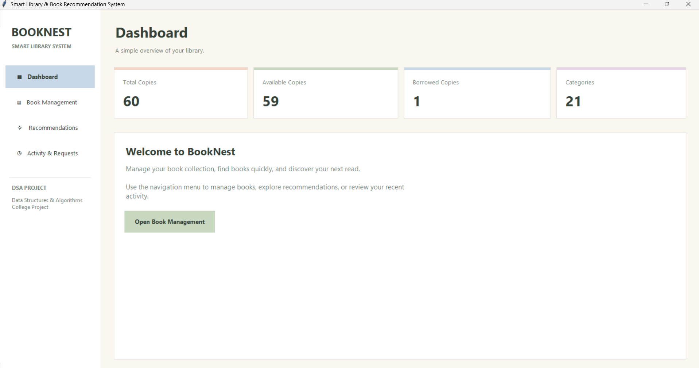

### 2. Book Management

View the book collection and manage library records.

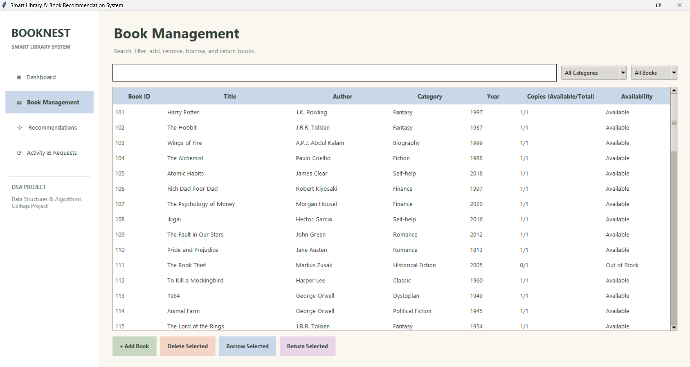

### 3. Add Book Form

Add a new book by entering its details, including quantity.

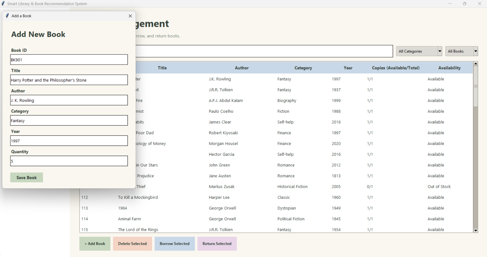

### 4. Book Added Successfully

View the newly added book in the library collection.

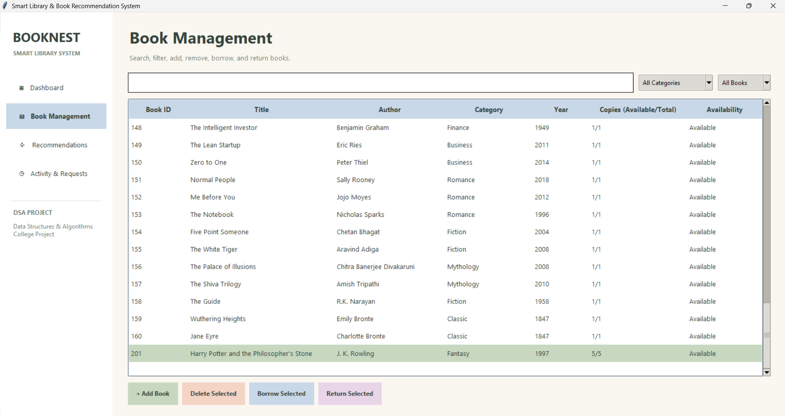

### 5. Search Books

Search for books using the application's supported search options.

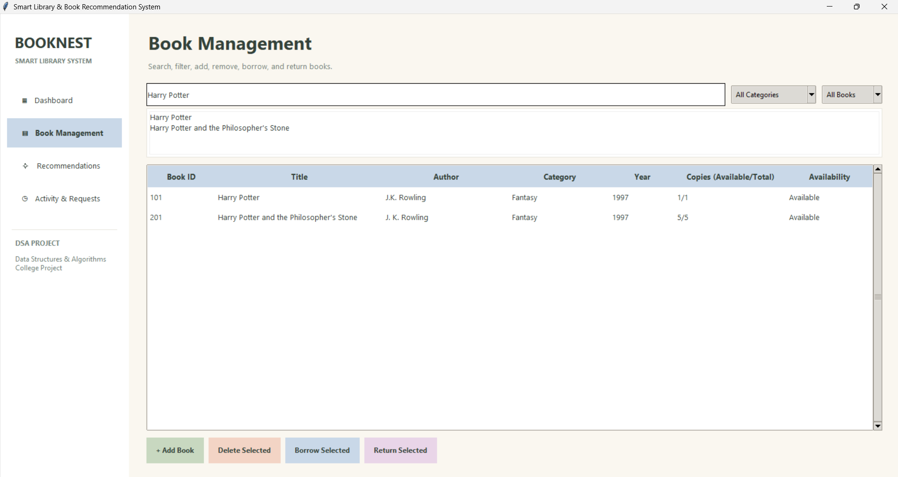

### 6. Delete Book

Remove a book record from the library.

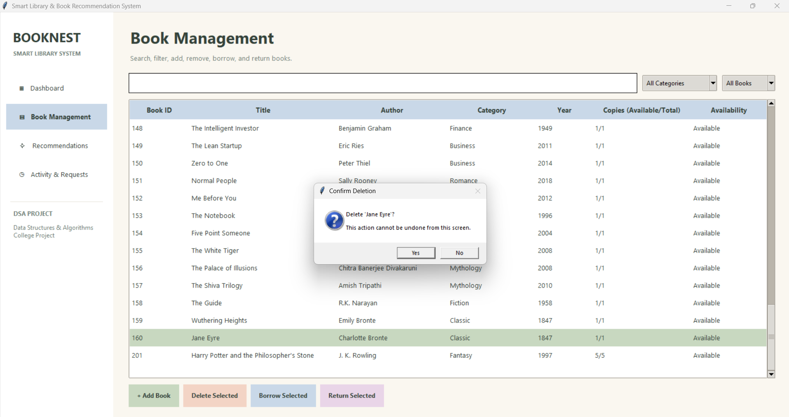

### 7. Borrow Book

Manage book borrowing and availability.


### 8. Book Quantity After Return

Verify the available quantity after a borrowed book is returned.

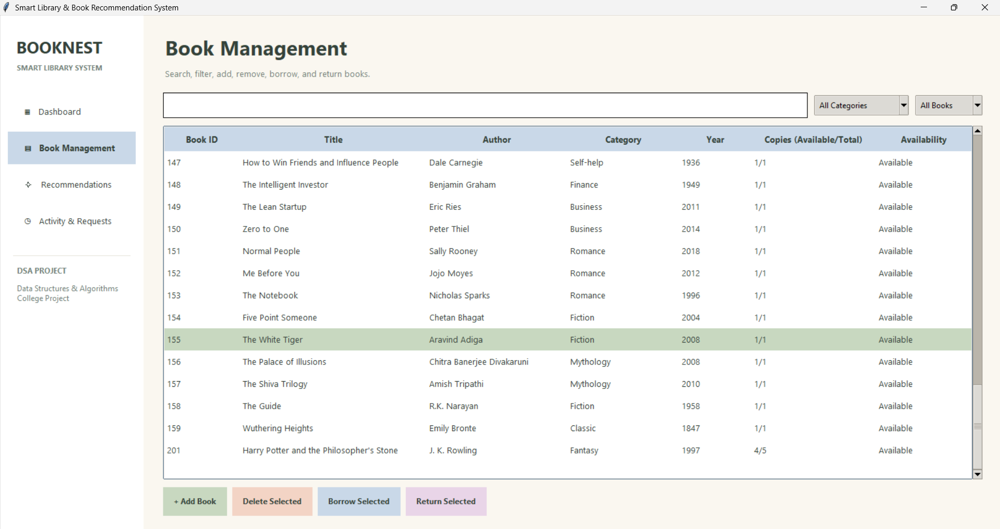

### 9. Book Recommendations

Explore book recommendations provided by the application.

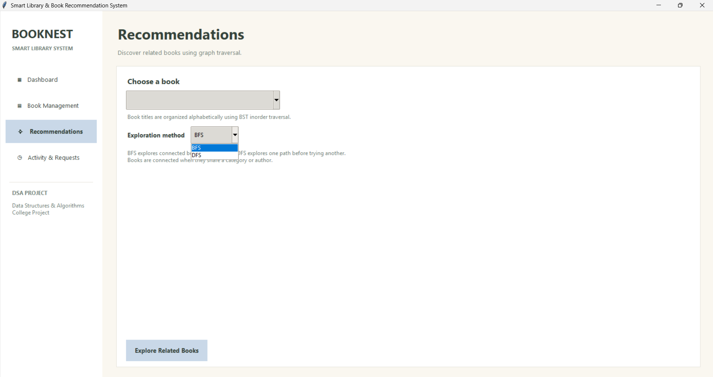

### 10. Recommendations Using BFS

Demonstration of Breadth-First Search (BFS) in the recommendation functionality.

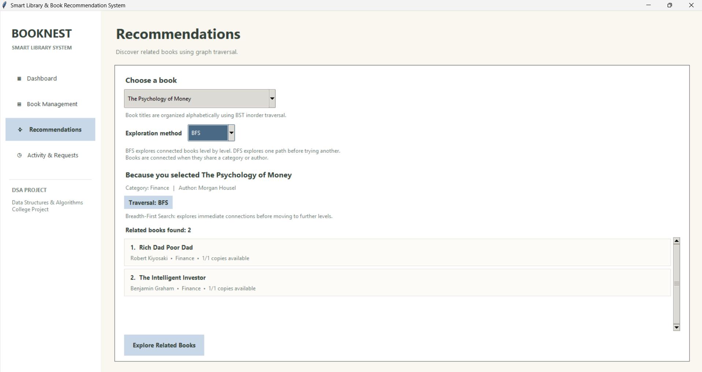

### 11. Recommendations Using DFS

Demonstration of Depth-First Search (DFS) in the recommendation functionality.

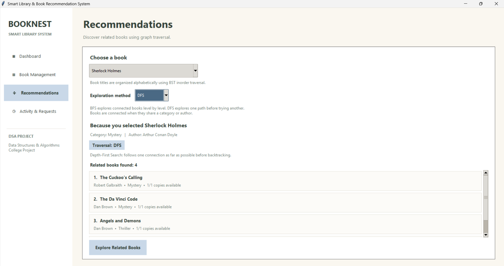

### 12. Activity History

Review library activities recorded by the application.

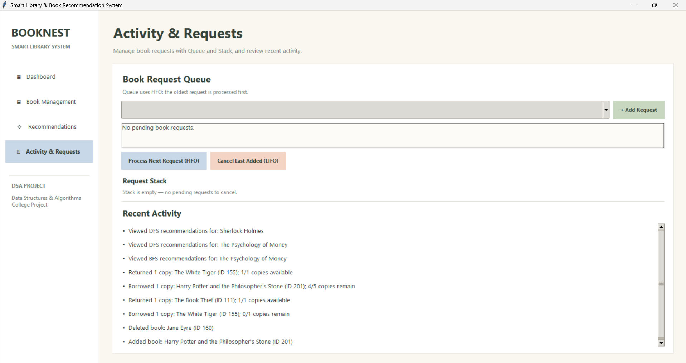

### 13. Borrowing Requests Queue

View pending requests managed using queue-based processing.

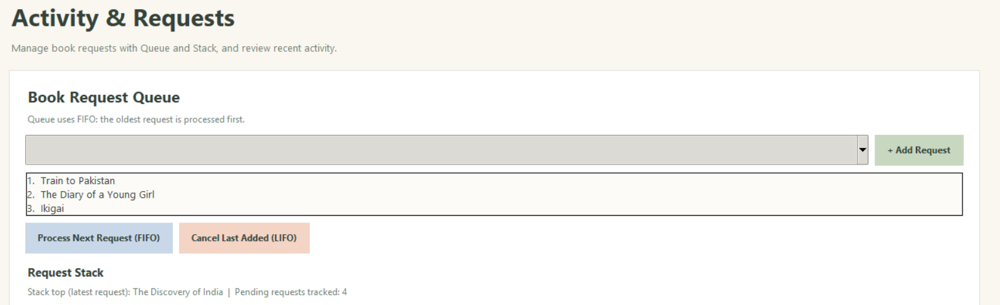

### 14. Next Request Using FIFO

Demonstration of First In, First Out (FIFO) request processing.

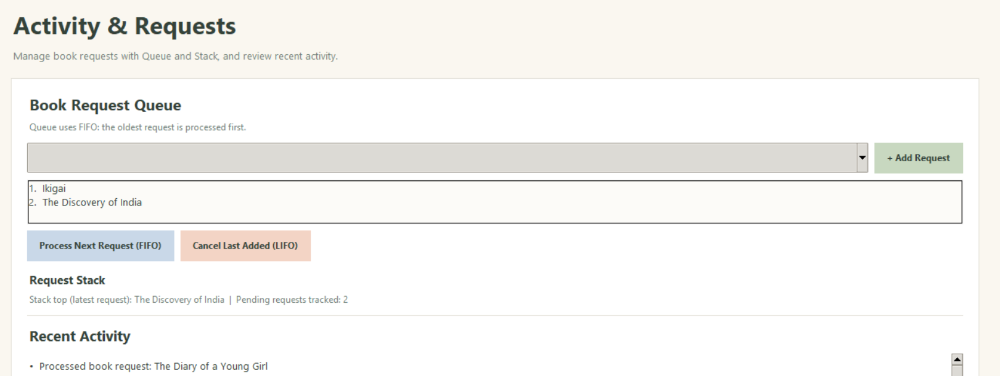

### 15. Last Added Item Using LIFO

Demonstration of Last In, First Out (LIFO) behaviour.

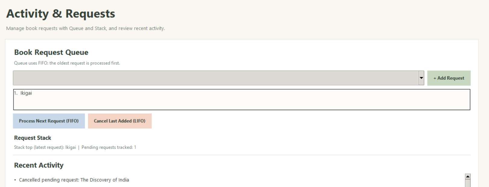

### 16. Dashboard After Operations

The dashboard after performing library operations.

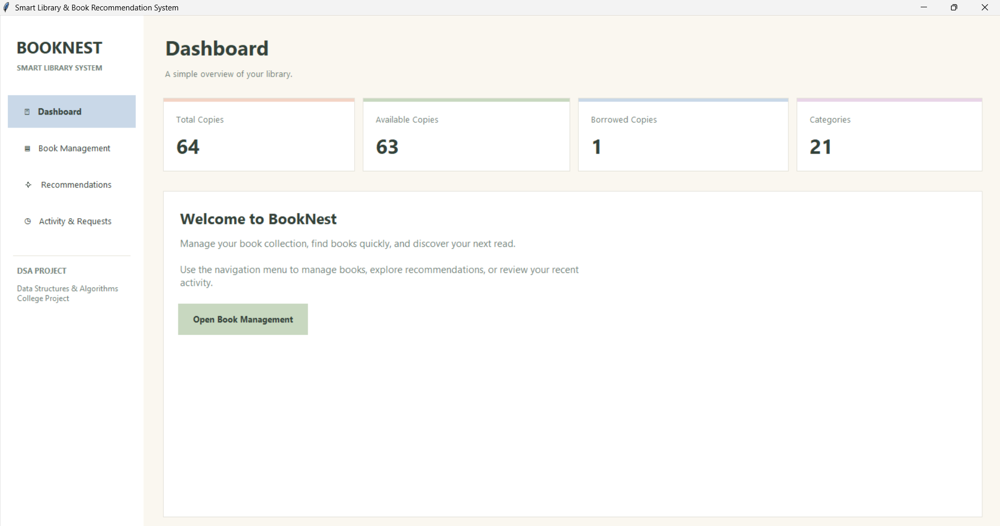

## 🛠️ Technologies Used

| Technology | Purpose |

|---|---|

| Python | Main programming language |

| Tkinter | Desktop graphical user interface |

| JSON | Book data storage |

| Git | Version control |

| GitHub | Source code hosting and collaboration |

| `unittest` | Automated testing |

---

## 📁 Project Structure

The repository contains the following main files and directories:

```text

Smart-Library-Book-Recommendation-System/

│

├── algorithms/

│   ├── balanced_trees.py

│   ├── dsu.py

│   ├── graphs.py

│   ├── hashing.py

│   ├── linked_list.py

│   ├── searching_sorting.py

│   ├── stack_queue.py

│   ├── trees.py

│   └── trie.py

│

├── try/

│   ├── test_algorithms.py

│   ├── test_balanced_trees.py

│   ├── test_dsu.py

│   ├── test_graphs.py

│   ├── test_hashing.py

│   ├── test_linked_list.py

│   ├── test_searching_sorting.py

│   ├── test_stack_queue.py

│   ├── test_trees.py

│   ├── test_trie.py

│   └── test_weighted_graphs.py

│

├── book_manager.py

├── books.json

├── gui.py

├── main.py

├── README.md

└── .gitignore

```

**Note:** The `try/` directory contains automated test files. The `algorithms/` directory contains the corresponding algorithm implementations. The actual contents of the repository may change as the project develops.

---

## 🧠 Data Structures and Algorithms Used

The project includes the following DSA implementations.

### 1. Searching and Sorting

- Linear Search

- Binary Search

- Bubble Sort

- Merge Sort

- Quick Sort

These algorithms demonstrate different ways to find and arrange data.

### 2. Linked Lists

Linked lists demonstrate how elements can be connected using nodes and how operations such as insertion, traversal, and deletion can be performed.

### 3. Stacks

Stacks follow the Last In, First Out (LIFO) principle. They are useful for operations where the most recently added item must be processed first.

### 4. Queues

Queues follow the First In, First Out (FIFO) principle and are suitable for processing requests in arrival order.

### 5. Deques and Priority Queues

- **Deque:** Supports insertion and removal at both ends.

- **Priority Queue:** Processes elements according to priority rather than only their arrival order.

### 6. Trees

- Binary Search Tree (BST)

- AVL Tree

- B-Tree

- B+ Tree

These tree structures demonstrate searching, ordering, balancing, and tree-based data organization.

### 7. Hashing

Hash tables support key-based data access and demonstrate how hashing can be used for efficient lookup operations.

### 8. Tries

Tries organize strings by their prefixes and can be used for prefix searching and autocomplete functionality.

### 9. Graphs

Graph implementations demonstrate:

- Breadth-First Search (BFS)

- Depth-First Search (DFS)

- Connected Components

- Weighted Graphs

- Minimum Spanning Tree algorithms

### 10. Disjoint Set Union (DSU)

DSU maintains groups of connected elements and supports union and connectivity operations.

**Academic note:** The presence of an algorithm in the repository does not necessarily mean that it is exposed as a separate button or feature in the graphical interface. The algorithm modules and their tests can also be demonstrated independently.

---

## 💻 Requirements

Before running the project, make sure your computer has:

- Python 3 installed.

- Tkinter available with your Python installation.

- A Windows, Linux, or macOS environment capable of running Tkinter.

- Git (optional, if you download the project as a ZIP file).

To check your Python installation, open Command Prompt or a terminal and execute:

```bash

python --version

```

On Windows, you can also use:

```bash

py --version

```

If the `python` command is not recognized, try `py` or install Python from the official website:

https://www.python.org/downloads/

During installation on Windows, enable the option to add Python to PATH if available.

---

## ⬇️ How to Download the Project

### Option 1: Download as a ZIP file

This is the easiest method for beginners.

1. Open the GitHub repository:

&#x20;  https://github.com/JidnyasaMude/Smart-Library-Book-Recommendation-System

2. Click the green **Code** button.

3. Select **Download ZIP**.

4. Wait for the download to finish.

5. Extract the downloaded ZIP file to a folder on your computer.

6. Open the extracted project folder in File Explorer or Visual Studio Code.

7. Open a terminal inside the folder.

You are now ready to run the project.

### Option 2: Clone using Git

If Git is installed, open a terminal and execute:

```bash

git clone https://github.com/JidnyasaMude/Smart-Library-Book-Recommendation-System.git

```

Navigate into the downloaded repository:

```bash

cd Smart-Library-Book-Recommendation-System

```

---

## ▶️ How to Run the Application

Follow these steps to launch the desktop application.

### Step 1: Open the project folder

Open the extracted `Smart-Library-Book-Recommendation-System` folder in Visual Studio Code or your preferred editor.

### Step 2: Open the terminal

In Visual Studio Code, select **Terminal → New Terminal**.

Make sure the terminal is opened in the project root directory, where `main.py`, `gui.py`, and `book_manager.py` are located.

### Step 3: Run the application

Execute:

```bash

python main.py

```

If you are using Windows and the `python` command does not work, try:

```bash

py main.py

```

### Step 4: Use the graphical interface

If the environment is configured correctly, the Tkinter application window should open.

Use the available interface to explore the library management functionality.

**Important:** This is a desktop application, not a website. It does not open at a local HTTP address such as `http://127.0.0.1:5000`. You run it on your computer using Python.

---

## 🧪 How to Run the Automated Tests

The repository includes automated tests for the algorithm modules.

### Step 1: Open the project root directory

Open a terminal in the folder containing the `algorithms/` and `try/` directories.

### Step 2: Execute the test command

Run:

```bash

python -m unittest discover -s try -p "test_*.py" -v

```

On Windows, you can also use:

```bash

py -m unittest discover -s try -p "test_*.py" -v

```

### Step 3: Check the results

The terminal displays each discovered test and its result.

A successful run ends with output similar to:

```text

----------------------------------------------------------------------

Ran 81 tests in 0.026s

OK

```

The execution time may differ between computers.

**Previously verified result:** The project test suite passed 81 automated tests in the development environment. Run the command on your own computer to verify the current version of the code.

---

## 💾 Data Storage

The project uses `books.json` to store book information.

This file is important because it provides the data used by the application. Keep it in the project root directory unless the code is updated to use a different location.

Before changing or deleting the file, create a backup if you want to preserve the existing book collection.

---

## 🔧 Troubleshooting

### Python is not recognized

Try:

```bash

py main.py

```

If that does not work, install Python and configure PATH.

### The application window does not open

Check that Python and Tkinter are installed and review any error messages printed in the terminal.

### A module cannot be imported

Ensure you are running the command from the project root directory and that the `algorithms/` folder is present.

### The test command finds no tests

Verify that the `try/` directory and the `test_*.py` files exist in the project root.

### Book data is missing

Check that `books.json` is present and contains valid JSON data.

---

## 🚀 Future Improvements

Potential improvements for future versions include:

- Expanding book recommendation logic.

- Improving search and filtering options.

- Adding persistent borrowing history.

- Enhancing error handling and input validation.

- Improving the graphical interface and accessibility.

- Expanding automated test coverage.

- Adding documentation and demonstrations for additional algorithms.

- Introducing a web-based interface as a separate future enhancement, if required.

---

## 👥 Project Team

This project is developed collaboratively by the following team members:

| Roll No. | Team Member Name |

|---:|---|

| 40 | Abhishek Reddy |

| 54 | Divya Tiwari |

| 58 | Janhavi Balpande |

| 67 | Jidnyasa Mude |

| 69 | Prathamesh Kale |

Developed as an academic project to demonstrate the application of Data Structures and Algorithms using Python.

## 📜 License

This project is intended for educational and learning purposes. If you plan to redistribute or reuse the code publicly, consider adding an explicit open-source license.

---

**Repository:**  

https://github.com/JidnyasaMude/Smart-Library-Book-Recommendation-System

If you find this project useful for learning Data Structures and Algorithms, feel free to explore the code and test the implementations.
